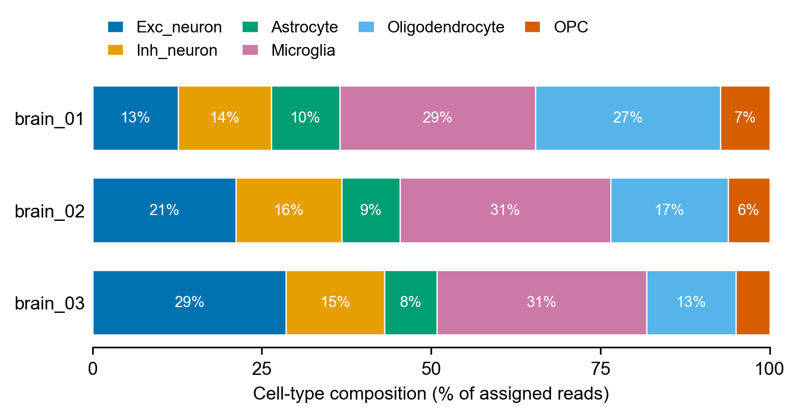
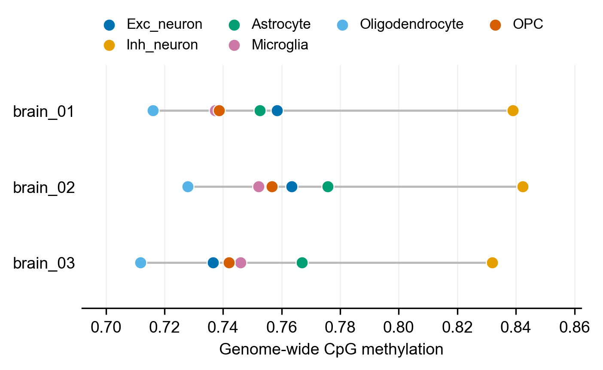
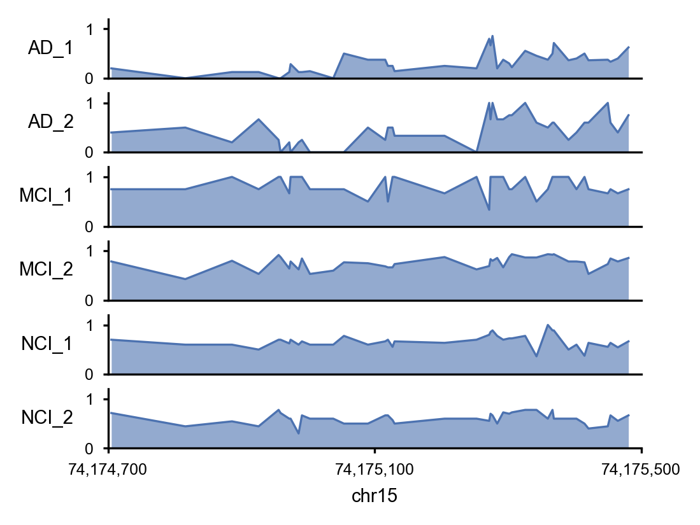

# COMET — Cell-of-Origin from METhylation

COMET assigns individual native long reads (PacBio HiFi or Oxford Nanopore) from bulk tissue to
their cell type of origin, using the CpG methylation pattern each read carries and a
cell-type reference methylation panel.

- `comet assign` splits each sample into cell-type read sets (BAM and/or per-site methylation
  BED) and reports and plots cell-type composition and cell-type-resolved genome-wide methylation.
- `comet dmr` calls differentially methylated regions between two groups of per-site BED
  files with metilene, e.g. one cell type across donor groups or one cell type against the others.


## Installation

**Bioconda**
```bash
conda install -c conda-forge -c bioconda comet-meth
```

**Container** (Docker)
```bash
docker pull ghcr.io/fanglab/comet-meth:1.1.0
docker run --rm -v /path/to/data:/data -v /path/to/ref_panel:/ref_panel ghcr.io/fanglab/comet-meth:1.1.0 \
      comet assign --bam /data/sample.bam ... --out /data/output   # mount every folder read or written
```

**From source**
```bash
git clone https://github.com/fanglab/COMET.git
conda env create -f COMET/environment.yml && conda activate comet
export PATH=$PWD/COMET/bin:$PATH
```

**Download the reference panel** (hg38; Zenodo DOI:
[10.5281/zenodo.24064938](https://doi.org/10.5281/zenodo.24064938)) into one folder and point COMET to it:
```bash
bash COMET/example/download_example_data.sh --ref-panel-dir /path/to/ref_panel --panels-only
# or download from the Zenodo page
export COMET_REF_PANEL_DIR=/path/to/ref_panel
```

## Requirements and Test

COMET is tested on Linux (x86-64). Bioconda, the container and `environment.yml` install
everything it needs:

| Software | Version | Used by |
|---|---|---|
| Python with numpy, pandas, scipy, pysam | Python ≥ 3.8, pysam ≥ 0.21 | `comet assign` |
| matplotlib, mscorefonts (Arial) | matplotlib ≥ 3.5 | `comet assign` visualization |
| modkit | 0.3.1 | `comet assign` ONT analysis|
| metilene, perl | 0.2.9 | `comet dmr` |
| samtools, bedtools, htslib (bgzip, tabix) | ≥ 1.15, ≥ 2.29, ≥ 1.15 | `comet assign` and `comet dmr` |

**Test the installation** with `comet test`. It downloads ~1.9 GB, then takes ~5 min with
16 threads. It runs four steps:

1. Checks the required tools and Python packages and prints their versions.
2. Runs `comet dmr` on the test BEDs bundled with COMET.
3. Downloads the test BAMs, plus the brain reference panel if `COMET_REF_PANEL_DIR` holds none,
   from Zenodo and checks their md5 sums.
4. Runs `comet assign` on the test BAMs.

Every result is compared with the expected values and reported as PASS or FAIL.

```bash
comet test --env-only                         # step 1 only (seconds, no download)
comet test --threads 16 --out comet_test      # all steps; downloads and outputs go to comet_test/
```

## Quick start

```bash
# Assign cell type for PacBio HiFi brain data
comet assign --platform pacbio --bam sample.bam --assign-thres 0.65 --out output/sample/

# Assign cell type for ONT brain data
comet assign --platform ont --bam sample.bam --fasta hg38.fa --assign-thres 0.65 --out output/sample/

# Assign cell type for ONT brain data with additional modification calls (5hmC at CpGs)
comet assign --platform ont --bam sample.bam --fasta hg38.fa --assign-thres 0.65 \
      --ont-mods 5mCG,5hmCG --out output/sample/
```

`--assign-thres` sets the minimum confidence for a read to be assigned to a cell type.
Value recommended from our simulations: **0.65** for brain.

Run `comet assign --help` or `comet dmr --help` for full usage information.

## Input and Output

### Cell type assignment

**Input:** an aligned, coordinate-sorted and indexed modBAM with MM/ML tags (hg38, chr1–chr22):
PacBio HiFi CCS reads with the `np` tag, or ONT reads from dorado (plus the reference FASTA).
Reads are assigned with the brain reference panel (6 cell types).

**Usage:** one or several samples in one call.

```bash
comet assign --platform pacbio --assign-thres 0.65 \
      --bam brain_01.bam,brain_02.bam,brain_03.bam \
      --threads 16 --out output/brain
```

**Output:** each sample's results are written to `output/brain/<sample>/`:
- **Read assignment:** per-read cell-type posteriors and assignments.
- **Reads per cell type:** BAMs and per-site methylation BEDs.
- **Quantification tables:** cell-type composition and genome-wide methylation of each cell type.

`output/brain/summary/` combines the tables and plots of all samples. For example, from three
postmortem brain samples:

**Cell-type composition** (`summary/all_samples.composition.tsv`, `.pdf/png`): proportions of
the reads assigned to a single cell type.

| sample | Exc_neuron | Inh_neuron | Astrocyte | Microglia | Oligodendrocyte | OPC |
|---|---|---|---|---|---|---|
| brain_01 | 0.127 | 0.137 | 0.101 | 0.289 | 0.273 | 0.073 |
| brain_02 | 0.212 | 0.157 | 0.086 | 0.311 | 0.173 | 0.062 |
| brain_03 | 0.286 | 0.145 | 0.078 | 0.309 | 0.132 | 0.050 |



**Cell-type-resolved methylation** (`summary/all_samples.gw_methylation.tsv`,
`all_samples.cell_type_methylation.pdf/png`): genome-wide CpG methylation of all reads (Bulk) and
of each cell type's reads.

| sample | Bulk | Exc_neuron | Inh_neuron | Astrocyte | Microglia | Oligodendrocyte | OPC |
|---|---|---|---|---|---|---|---|
| brain_01 | 0.795 | 0.758 | 0.839 | 0.753 | 0.737 | 0.716 | 0.739 |
| brain_02 | 0.815 | 0.763 | 0.842 | 0.776 | 0.752 | 0.728 | 0.757 |
| brain_03 | 0.796 | 0.737 | 0.832 | 0.767 | 0.746 | 0.712 | 0.742 |



➡ **[comet assign: full usage](docs/assign.md)**

### DMR analysis

**Input:** per-site methylation BED files (chrom, start, end, n_mod, n_total), e.g. the cell-type
BEDs written by `comet assign`. Give them as two groups: `--target` and `--background`.

**Usage:**

```bash
comet dmr --target AD_1.Microglia.CG.bed.gz,AD_2.Microglia.CG.bed.gz --target-name AD_Microglia \
      --background MCI_1.Microglia.CG.bed.gz,MCI_2.Microglia.CG.bed.gz,NCI_1.Microglia.CG.bed.gz,NCI_2.Microglia.CG.bed.gz \
      --background-name MCI_NCI_Microglia --dmr-diff 0.2 --dmr-level individual --out output/dmr
```

DMRs are called with metilene, then filtered by `--dmr-diff`, CpG count and depth, at group or
individual level (`--dmr-level`).

**Output:** `output/dmr/01.dmr/` has every DMR metilene reported (`*.all.tsv`), with group means,
the methylation level of each input file (`mean_<sample>`), statistics and filter flags. The
significant DMRs are also written as `*.sig.tsv` and `*.sig.bed`.

For example: microglia of two AD samples against microglia of two MCI and two NCI samples, at
`--dmr-level individual`, so each region differs from all four by at least 0.2.
Two DMRs fall in chr15:74,174,956-74,175,254 (methylation columns are `mean_<sample>`; the target
comes first):

| chrom | start | end | n_cpg | AD_1 | AD_2 | MCI_1 | MCI_2 | NCI_1 | NCI_2 | min_individual_diff |
|---|---|---|---|---|---|---|---|---|---|---|
| chr15 | 74174956 | 74175055 | 9 | 0.147 | 0.114 | 0.879 | 0.727 | 0.663 | 0.590 | 0.443 |
| chr15 | 74175090 | 74175254 | 7 | 0.263 | 0.346 | 0.792 | 0.716 | 0.647 | 0.590 | 0.244 |

The six methylation columns show DMR methylation levels. The target (AD microglia) comes first.

The region is unmethylated in AD microglia and methylated in MCI and NCI microglia:



➡ **[comet dmr: full usage](docs/dmr.md)**
