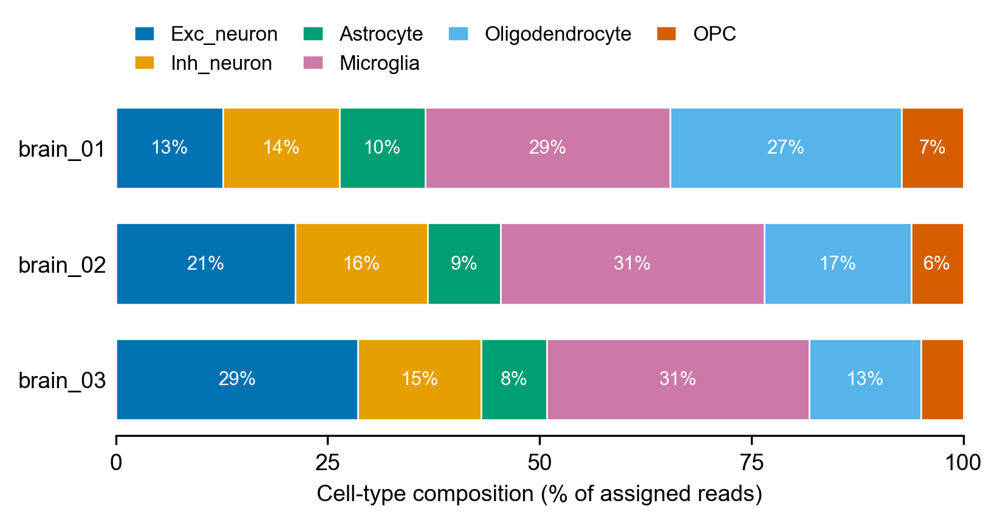
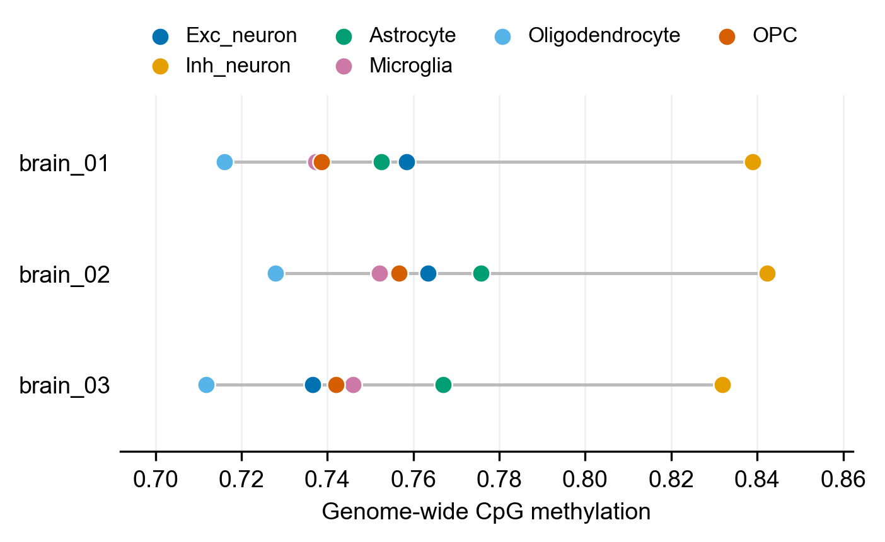

# comet assign — cell-type assignment

`comet assign` scores every read of a bulk-tissue modBAM against a cell-type reference
methylation panel, assigns it to its cell type of origin, and writes the reads of each cell type
(BAM and/or per-site methylation BED), the cell-type composition, the genome-wide methylation of
each cell type and plots of both.

- [Usage](#usage)
- [Input](#input)
- [Parameters](#parameters)
- [Output](#output)
- [Several samples](#several-samples)
- [Parallel execution](#parallel-execution)
- [Example: three postmortem brain samples](#example-three-postmortem-brain-samples)

## Usage

```bash
comet assign --platform {pacbio,ont} --bam SAMPLE.bam \
      --assign-thres 0.65 --out OUT_DIR [options]
```

More examples:

```bash
# PacBio HiFi, brain
comet assign --platform pacbio --bam sample.bam --assign-thres 0.65 \
      --threads 16 --out results/sample

# ONT, brain, also write 5hmC at CpGs
comet assign --platform ont --bam sample.bam --fasta hg38.fa --assign-thres 0.65 \
      --ont-mods 5mCG,5hmCG --threads 16 --out results/sample

# several samples in one call
comet assign --platform pacbio --assign-thres 0.65 \
      --bam brain_01.bam,brain_02.bam --threads 16 --out results/brain
```

## Input

- **modBAM:** aligned, coordinate-sorted and indexed, with MM/ML tags (hg38, chr1–chr22).
  - **PacBio HiFi:** CCS reads with the `np` tag (5mC from kinetics).
  - **ONT:** modBAMs from dorado (tested with dorado v1.0.2). Supported models: 5mCG,
    5mCG_5hmCG, 5mC and 5mC_5hmC. `--ont-mods` selects which of 5mCG (default), 5hmCG, 5mCH and
    5hmCH are written as per-site BEDs. COMET checks the BAM first and stops if a requested
    modification is not present.
- **Reference panel:**
  - **Built-in (brain):** download it from Zenodo (see
    [Installation](../README.md#installation)) and set `COMET_REF_PANEL_DIR` or `--ref-panel-dir`.
    - brain (6 cell types): Exc_neuron, Inh_neuron, Astrocyte, Microglia, Oligodendrocyte, OPC
- **Reference FASTA (`--fasta`):** needed for ONT only (used by modkit).

## Parameters

| Option | Default | |
|---|---|---|
| `--platform` | required | `pacbio` or `ont` |
| `--bam` | required | modBAM; several samples: comma-separated, or a text file with one BAM per line |
| `--assign-thres` | required | minimum confidence (posterior θ) for a read to be assigned to a cell type; recommended from our simulations: 0.65 for brain |
| `--out` | required | output directory |
| `--fasta` | | reference FASTA (required for `--platform ont`) |
| `--output-format` | both | `bam` (reads of each cell type), `bed-call` (per-site calls of each read set) or `both` |
| `--ont-mods` | 5mCG | ONT: modifications written as per-site BEDs (5mCG, 5hmCG, 5mCH, 5hmCH). Read assignment always uses CpG 5mC (+ 5hmC if present) |
| `--ml-cutoff` | 180 | methylation call confidence cutoff τ0 on the 0–255 ML scale (paper: 180) |
| `--threads` | 4 | parallel workers |
| `--sample` | BAM basename | sample name(s), comma-separated, one per BAM |
| `--no-plot` | | do not draw the composition and methylation plots |
| `--meth-plot-samples` | all | samples shown in the cell-type methylation plot |
| `--cell-types` | brain names | cell-type names in panel column order |
| `--ref-panel-dir` | `$COMET_REF_PANEL_DIR` | folder holding `brain.atlas.bed.gz(.tbi)` |
| `--no-lineage` | | brain: turn off lineage rescue (Neuron = Exc + Inh; Macroglia = Astrocyte + Oligodendrocyte + OPC) |
| `--lineage-thres` | 0.65 | summed-posterior cutoff for lineage rescue |
| `--lineage-margin` | 0.10 | margin over the best outside cell type for lineage rescue |
| `--min-cpg` | 5 | minimum informative CpGs per read |
| `--min-read-len` | 7500 / 500 | minimum read length (PacBio / ONT) |
| `--chunk-size` | 10000 / 500000 | reads (PacBio) or calls (ONT) per chunk |
| `--no-pn-calibration` | | PacBio: use τ0 for every pass number |
| `--pn-table` | | PacBio: use an existing pass-number table instead of calibrating |
| `--hmc-cutoff` | 225 | ONT: a 5hmC call with ML ≥ this replaces the 5mC call |
| `--pileup-threshold` | 0.70 | ONT: modkit pileup `--filter-threshold` for CpG calls |
| `--ch-pileup-threshold` | 0.95 | ONT: modkit pileup `--filter-threshold` for CH calls |
| `--modkit` | modkit | modkit executable |
| `--keep-tmp` | | keep intermediate chunk files |
| `--step`, `--chunk-id` | all | run one step only, see [Parallel execution](#parallel-execution) |

`comet assign --help` prints the same list.

## Output

```
OUT/
├── 01.cell_type_assignment/
│   ├── cell_type_prob/         per-read posteriors and assignment
│   ├── read_list/              read IDs per cell type (and brain lineage)
│   ├── BAM/                    reads per cell type            (--output-format bam | both)
│   └── BED/                    per-site calls per read set    (--output-format bed-call | both)
├── 02.cell_type_quantification/
│   ├── SAMPLE.composition.tsv  cell-type proportions (three denominators)
│   ├── SAMPLE.gw_methylation.tsv
│   └── SAMPLE.composition.pdf/png, SAMPLE.cell_type_methylation.pdf/png   (--no-plot: none)
└── 03.run_info/
    ├── OUTPUT_README.txt       description of every file this run produced
    ├── run_parameters.txt      command, parameters, tool versions
    ├── SAMPLE.pass_number_table.tsv   (PacBio)
    └── logs/
```

- **`cell_type_prob/SAMPLE.cell_type_prob.tsv`:** one row per scored read (≥ `--min-cpg`
  informative CpGs): read_id, n_cpg, label (panel column, 0 = unassigned), cell_type, the
  posterior of each cell type, rescued_lineage. A read is assigned when its top posterior is
  ≥ `--assign-thres` and ≥ 2× the runner-up.
- **`BAM/cell_type/SAMPLE.<cell type>.bam`:** the reads of each cell type with all tags kept,
  indexed. Use it like a sorted-cell library with any methylation tool.
- **`BED/{bulk,cell_type}/SAMPLE.<set>.<mod>.bed.gz`:** per-site calls, bgzipped and
  tabix-indexed: chrom, start (0-based), end, n_mod, n_total. These are the input of
  [`comet dmr`](dmr.md).
- **`SAMPLE.composition.tsv`:** group, n_reads and three proportions:
  - `frac_single`: among reads assigned to a single cell type.
  - `frac_single_lineage`: also counting lineage-rescued reads.
  - `frac_all`: among all scored reads, including unassigned ones.
- **`SAMPLE.gw_methylation.tsv`:** genome-wide CpG methylation of each read set (Bulk, each cell
  type, Unassigned) from all CpG calls of its reads.

`03.run_info/OUTPUT_README.txt` describes every file of the run with the exact cutoffs used.

## Several samples

With several BAMs (`--bam a.bam,b.bam`, or a text file with one BAM per line), each sample is run
in turn into `OUT/<sample>/` (layout as above). `OUT/summary/` then holds:

- `all_samples.composition.tsv` and `all_samples.gw_methylation.tsv`: every sample's tables, with
  a leading `sample` column.
- `all_samples.composition.pdf/png`: stacked bars of cell-type composition (`frac_single`), one
  bar per sample.
- `all_samples.cell_type_methylation.pdf/png`: dot plot of each cell type's genome-wide
  methylation, one row per sample. Use `--meth-plot-samples` to restrict the rows.

Rerunning the same command skips samples that already finished with identical settings. Plots
use matplotlib and Arial (conda package `mscorefonts`, installed with COMET).

## Parallel execution

`--threads N` runs N independent workers on one machine (no scheduler needed). On a cluster, the
three steps can be submitted separately, with the middle one as an array job (one BAM per run):

```bash
comet assign ... --step prepare
comet assign ... --step chunks --chunk-id $LSB_JOBINDEX     # or $SLURM_ARRAY_TASK_ID; 1..N
comet assign ... --step finalize
```

N is the number of lines in `OUT/tmp/chunks.list`. A failed run resumes where it stopped.

## Example: three postmortem brain samples

The example runs one call on three PacBio HiFi postmortem brain samples (`brain_01`, `brain_02`,
`brain_03`), each downsampled to 0.5X. The BAMs keep autosomal reads only. Base qualities and all
tags except `np`, `MM`, `ML` and `RG` are removed, because COMET does not use them.

The BAMs (1.3 GB) are on Zenodo ([10.5281/zenodo.24064938](https://doi.org/10.5281/zenodo.24064938)) together with the brain
reference panel. `example/download_example_data.sh` fetches them into `example/data/assign/` and
checks their md5 sums.

```bash
cd COMET
bash example/download_example_data.sh --ref-panel-dir ref_panel   # BAMs + brain panel (613 MB)
export COMET_REF_PANEL_DIR=$PWD/ref_panel                          # skip if the panel is already set up
bash example/run_example.sh 16                                     # ~5 min with 16 threads
```

`run_example.sh` runs, from `example/`:

```bash
comet assign --platform pacbio --assign-thres 0.65 \
      --bam data/assign/brain_01.bam,data/assign/brain_02.bam,data/assign/brain_03.bam \
      --threads 16 --out output/assign
```

### Results

The expected results are in [`example/output/assign/`](../example/output/assign/).

- **Shipped in the repository:** the tables, plots and run records.
- **Not shipped (too large):** the per-read tables, read lists, cell-type BAMs and BEDs in
  `<sample>/01.cell_type_assignment/`. `run_example.sh` regenerates them.

**Cell-type composition** (`summary/all_samples.composition.pdf`): the excitatory neuron share
rises from brain_01 to brain_03 (13%, 21%, 29%) while the oligodendrocyte share falls (27%, 17%, 13%).



**Cell-type-resolved methylation** (`summary/all_samples.cell_type_methylation.pdf`): genome-wide
CpG methylation of each cell type's reads.



`summary/all_samples.composition.tsv`: `frac_single` of each cell type, plus `frac_all` of the
Unassigned group (unassigned share of all scored reads).

| sample | Exc_neuron | Inh_neuron | Astrocyte | Microglia | Oligodendrocyte | OPC | Unassigned reads |
|---|---|---|---|---|---|---|---|
| brain_01 | 0.127 | 0.137 | 0.101 | 0.289 | 0.273 | 0.073 | 33.8% |
| brain_02 | 0.212 | 0.157 | 0.086 | 0.311 | 0.173 | 0.062 | 35.4% |
| brain_03 | 0.286 | 0.145 | 0.078 | 0.309 | 0.132 | 0.050 | 30.3% |

`summary/all_samples.gw_methylation.tsv`: genome-wide CpG methylation of all reads (Bulk) and of
each cell type's reads.

| sample | Bulk | Exc_neuron | Inh_neuron | Astrocyte | Microglia | Oligodendrocyte | OPC |
|---|---|---|---|---|---|---|---|
| brain_01 | 0.795 | 0.758 | 0.839 | 0.753 | 0.737 | 0.716 | 0.739 |
| brain_02 | 0.815 | 0.763 | 0.842 | 0.776 | 0.752 | 0.728 | 0.757 |
| brain_03 | 0.796 | 0.737 | 0.832 | 0.767 | 0.746 | 0.712 | 0.742 |
