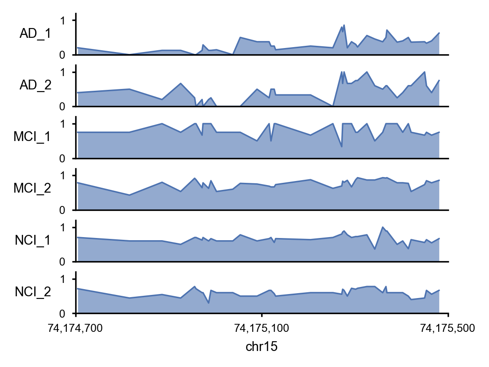

# comet dmr — DMR analysis

`comet dmr` calls differentially methylated regions (DMRs) between a target group and a
background group of per-site methylation BED files with
[metilene](https://legacy.bioinf.uni-leipzig.de/Software/metilene/), and filters them by
methylation difference, CpG count and depth. A typical use is one cell type across two donor
groups, using the cell-type BEDs from [`comet assign`](assign.md).

- [Usage](#usage)
- [Input](#input)
- [Parameters](#parameters)
- [Output](#output)
- [Example](#example-an-ad-specific-microglia-dmr)

## Usage

```bash
comet dmr --target FILES --background FILES --dmr-diff 0.3 --out OUT_DIR [options]
```

```bash
# DMRs of microglia between AD and control donors (files from comet assign, BED/cell_type/)
comet dmr --target AD1.Microglia.mCG.bed.gz,AD2.Microglia.mCG.bed.gz --target-name AD \
      --background CT1.Microglia.mCG.bed.gz,CT2.Microglia.mCG.bed.gz --background-name control \
      --dmr-diff 0.3 --threads 8 --out results/dmr_microglia
```

## Input

`--target` and `--background` are each a comma-separated list of per-site BED files, or a text
file with one path per line.

- **Columns:** chrom, start (0-based), end, n_mod, n_total.
- **Format:** plain or gzipped.
- **Source:** written by `comet assign` in `01.cell_type_assignment/BED/`. Any per-site counts
  in this format work.

Differences are reported as target − background.

## Parameters

| Option | Default | |
|---|---|---|
| `--target` | required | target group files |
| `--background` | required | background group files |
| `--dmr-diff` | required | minimum \|methylation difference\| (fraction, e.g. 0.3) |
| `--out` | required | output directory |
| `--dmr-level` | group | `group`: group means differ by ≥ `--dmr-diff`. `individual`: also every target file differs from every background file by ≥ `--dmr-diff`, in the same direction |
| `--target-name`, `--background-name` | target, background | group labels in outputs |
| `--min-cpg` | 5 | minimum CpGs in a DMR |
| `--max-gap` | 300 | maximum bp between neighbouring CpGs in a DMR (metilene `-M`) |
| `--min-depth` | 3 | minimum mean depth over the DMR in every sample used |
| `--aggregate` | off | pool each group's files into one and run 1 vs 1 (for shallow cell types) |
| `--alpha` | 0.05 | metilene BH-adjusted q-value cutoff |
| `--name` | TARGET_vs_BACKGROUND | output file prefix |
| `--threads` | 4 | threads |
| `--metilene` | on PATH | metilene executable (`metilene_input.pl` expected next to it) |
| `--keep-tmp` | | keep intermediate files |

metilene settings, as in the COMET manuscript: de novo mode, `-X/-Y` = ceil(n/2) samples per
group, `-M` max-gap, `-c 2` (BH), `-m` min-cpg, `-d` dmr-diff.

## Output

```
OUT/
├── 01.dmr/
│   ├── NAME.metilene.all.tsv     every region reported by metilene, with all filters
│   ├── NAME.metilene.sig.tsv     rows of all.tsv with significant = 1
│   ├── NAME.metilene.sig.bed     the same regions as BED (name = TARGET:<difference>)
│   └── NAME.metilene.raw.tsv     unmodified metilene output
└── 02.run_info/
    ├── OUTPUT_README.txt     description of every file and column
    ├── run_parameters.txt    command, parameters, tool versions
    ├── input_files.tsv       sample name, group and path of every input file
    └── logs/
```

Each region (row of `all.tsv` / `sig.tsv`) carries:
- **Region:** chrom, start, end, n_cpg.
- **Group means:** the mean of each group and their difference.
- **metilene statistics:** p_value (MWU), q_value (BH), statistic (2D-KS p-value).
- **Depth and individual difference:** `min_mean_depth` and `min_individual_diff`.
- **Filter flags:** `pass_dmr_diff`, `pass_individual_diff`, `pass_min_cpg`, `pass_min_depth`
  and the final `significant`.
- **Per-sample values:** `mean_<sample>`, the methylation level of each input file over the
  region (summed n_mod / n_total). `meth_<sample>` and `total_<sample>` are the summed counts.

## Example: an AD-specific microglia DMR

The example uses per-site CpG calls of the six brain cell types of six deeply sequenced postmortem
brain samples, two per group: AD (`AD_1`, `AD_2`), MCI (`MCI_1`, `MCI_2`) and NCI (`NCI_1`,
`NCI_2`) (`brain_deep_<sample>.<cell_type>.CG.bed.gz`). They were made by `comet assign` and cut
to chr15:73,500,000-75,500,000. The files (4.5 MB) are in the repository under
[`example/data/dmr/`](../example/data/dmr/), so this part needs no download.

The microglia of the two AD samples are compared with the microglia of the four MCI and NCI
samples. With `--dmr-level individual`, each AD sample must differ from each of the four by at
least `--dmr-diff`, in the same direction.

```bash
cd COMET/example
D=data/dmr/brain_deep
comet dmr --target ${D}_AD_1.Microglia.CG.bed.gz,${D}_AD_2.Microglia.CG.bed.gz --target-name AD_Microglia \
      --background ${D}_MCI_1.Microglia.CG.bed.gz,${D}_MCI_2.Microglia.CG.bed.gz,${D}_NCI_1.Microglia.CG.bed.gz,${D}_NCI_2.Microglia.CG.bed.gz \
      --background-name MCI_NCI_Microglia --dmr-diff 0.2 --dmr-level individual --out output/dmr
```

This takes a few seconds. `bash example/run_example.sh` runs it after the `comet assign`
example and also draws the track plot below.

### Results

Expected results: [`example/output/dmr/`](../example/output/dmr/). 3 DMRs pass
(`01.dmr/AD_Microglia_vs_MCI_NCI_Microglia.metilene.sig.tsv`, selected columns):

| chrom | start | end | n_cpg | mean_MCI_NCI_Microglia | AD_1 | AD_2 | MCI_1 | MCI_2 | NCI_1 | NCI_2 | min_individual_diff |
|---|---|---|---|---|---|---|---|---|---|---|---|
| chr15 | 74174956 | 74175055 | 9 | 0.718 | 0.147 | 0.114 | 0.879 | 0.727 | 0.663 | 0.590 | 0.443 |
| chr15 | 74175090 | 74175254 | 7 | 0.689 | 0.263 | 0.346 | 0.792 | 0.716 | 0.647 | 0.590 | 0.244 |
| chr15 | 74256583 | 74256796 | 5 | 0.492 | 0.824 | 0.833 | 0.464 | 0.608 | 0.333 | 0.611 | 0.212 |

- **Six methylation columns:** `mean_<sample>`, the methylation level (summed n_mod / n_total)
  of the microglia of each sample over the DMR. AD_1 and AD_2 are the target.
- **`mean_MCI_NCI_Microglia`:** the background group mean reported by metilene.
- **`min_individual_diff`:** the smallest gap between any target file and any background file; at
  `--dmr-level individual` it must be ≥ `--dmr-diff`.

Two adjacent DMRs cover chr15:74,174,956-74,175,254 (16 CpGs). The region is unmethylated in AD
microglia and methylated in MCI and NCI microglia:



The tracks show per-CpG microglia methylation over chr15:74,174,700-74,175,500 (CpGs with ≥ 1 read).

`comet dmr` does not draw plots. This one comes from `example/plot_dmr_region.py`, which works
for any region and any per-site BEDs from `comet assign`:

```bash
cd COMET/example
# per-CpG tracks, one --track LABEL=BED per track, top to bottom
# (several comma-separated BEDs in one track are pooled)
python3 plot_dmr_region.py --region chr15:74,174,700-74,175,500 --min-depth 1 \
      --track AD_1=data/dmr/brain_deep_AD_1.Microglia.CG.bed.gz \
      --track AD_2=data/dmr/brain_deep_AD_2.Microglia.CG.bed.gz \
      ...
      --out output/dmr/AD_microglia.tracks
```
